# Starter-Demo für REDAXO

**Lehrstück und Startpunkt: eine zweisprachige Beispiel-Website – nur mit dem, was REDAXO mitbringt, plus YForm und YRewrite.**

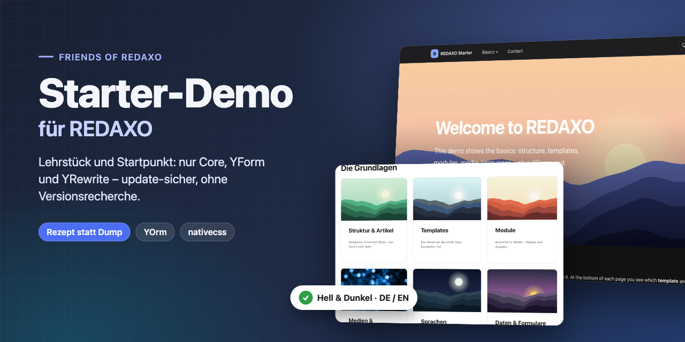

Jede Seite der Demo erklärt ein Stück REDAXO – und ist selbst damit gebaut. Unten auf jeder Seite steht, welches
Template und welche Module sie verwendet. Wer das Backend daneben öffnet, sieht sofort, wie es gemacht ist.

Und sie veraltet nicht: Statt fester AddOn-Versionen und eines Datenbank-Dumps beschreibt ein lesbares **Rezept**, was es
geben soll. Angelegt wird alles über die Schnittstellen von REDAXO, die passenden AddOn-Versionen sucht die Demo selbst.

## Auf einen Blick

- **Nur Bordmittel** – Struktur, Templates, Module, Medienpool, Media Manager, Metainfos, PHPMailer – plus **YForm** und **YRewrite**
- **Zweisprachig** Deutsch / Englisch mit sprechenden Adressen (`/de/grundlagen/module/`, `/en/basics/modules/`)
- **Neun kommentierte Module** und drei Templates, jedes zeigt eine Technik
- **YForm mit YOrm**: Termine als Datenliste, Kontaktformular direkt aus der Tabellendefinition – ohne Pipe-Notation
- **Hell und dunkel** – folgt dem System oder dem Schalter in der Kopfzeile
- **Natives CSS** mit [nativecss](https://github.com/skerbis/nativecss): kein Framework, kein Build-Schritt, fließende Typografie
- **Ohne Versionsrecherche**: fehlende AddOns holt die Demo über den Installer – mit Versionsbedingung statt fester Version
- **Update-sicher**: erneutes Einrichten ergänzt, was fehlt, und überschreibt nie, was Sie geändert haben

---

## Die Website

| Hell | Dunkel, englisch |
|---|---|
| 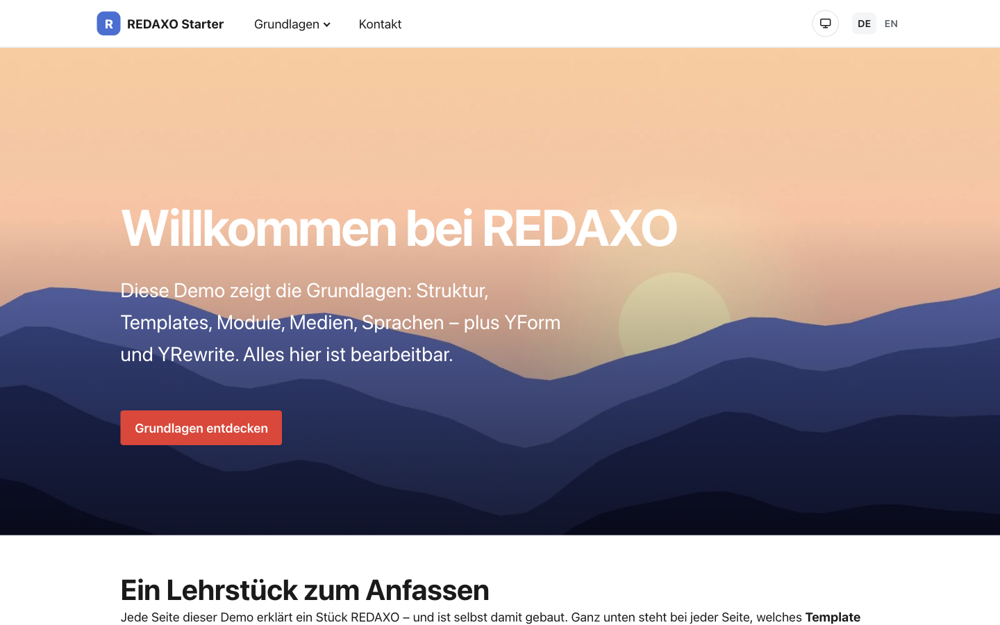 | 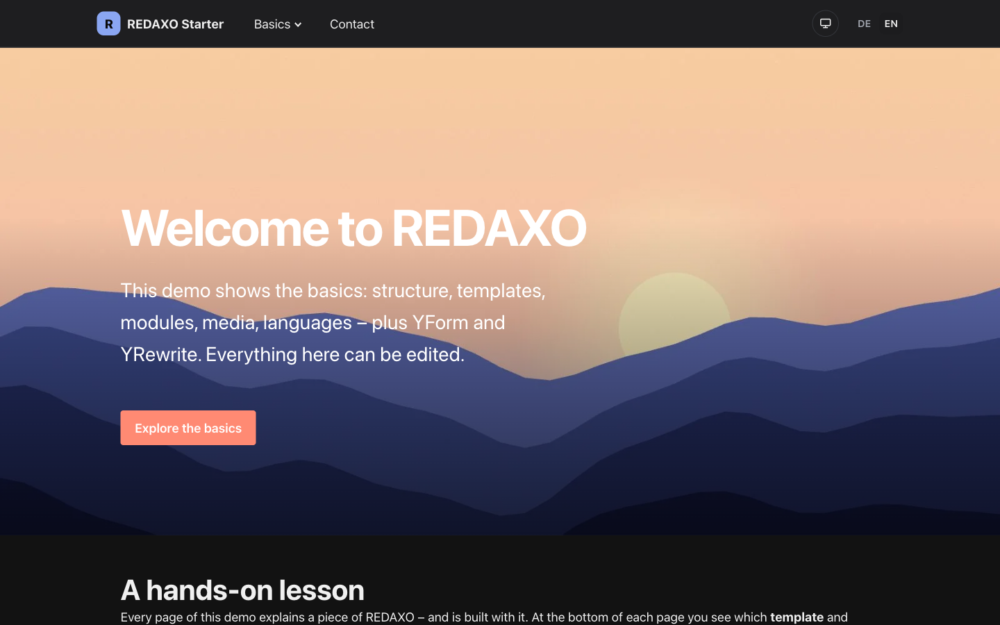 |

Die **Karten** füllen sich selbst aus der Struktur: neue Seite in der Kategorie anlegen – schon erscheint sie. Bild und
Kurztext kommen aus den Metadaten der Seite.

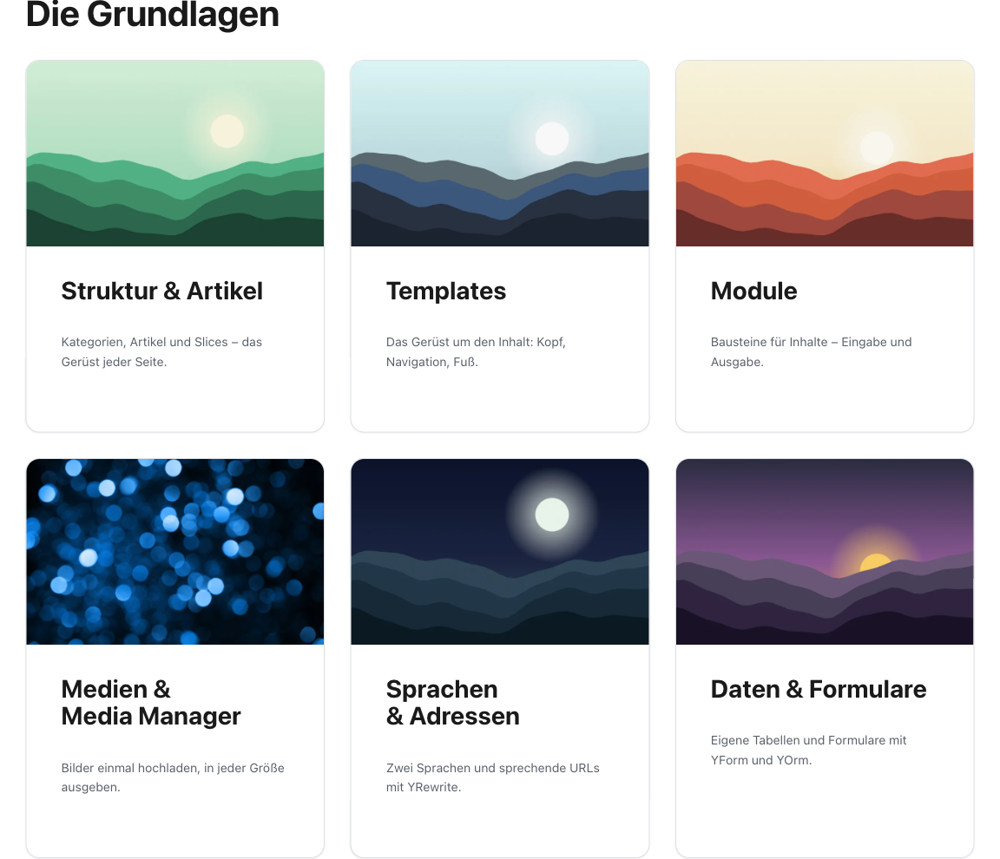

Sechs Seiten erklären die **Grundlagen**: Struktur & Artikel, Templates, Module, Medien & Media Manager, Sprachen &
Adressen, Daten & Formulare. Jede mit einem Kasten „Im Backend ansehen“.

| Module – mit Bildergalerie | Daten & Formulare – Termine per YOrm |
|---|---|
| 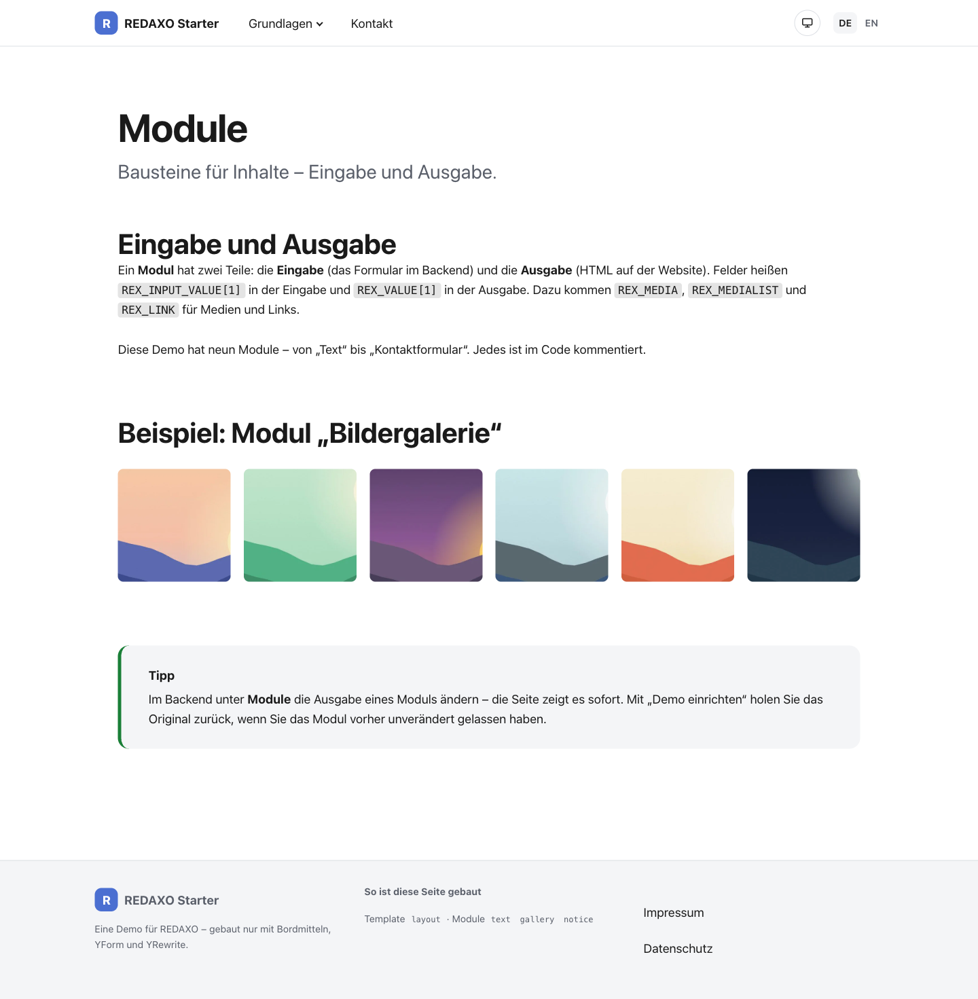 | 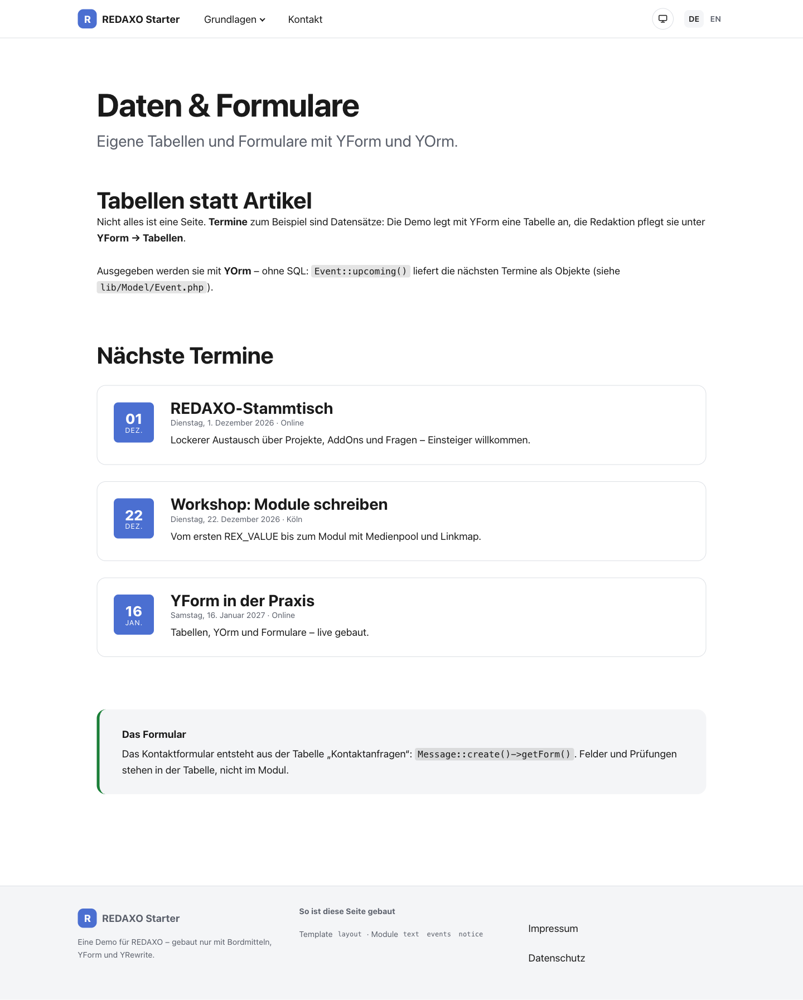 |

Das **Kontaktformular** entsteht aus der YForm-Tabelle „Kontaktanfragen“ – Felder, Beschriftungen und Prüfungen stehen in
der Tabelle, nicht im Modul. Unten auf jeder Seite: **So ist diese Seite gebaut**.

| Kontaktformular | Handy |
|---|---|
| 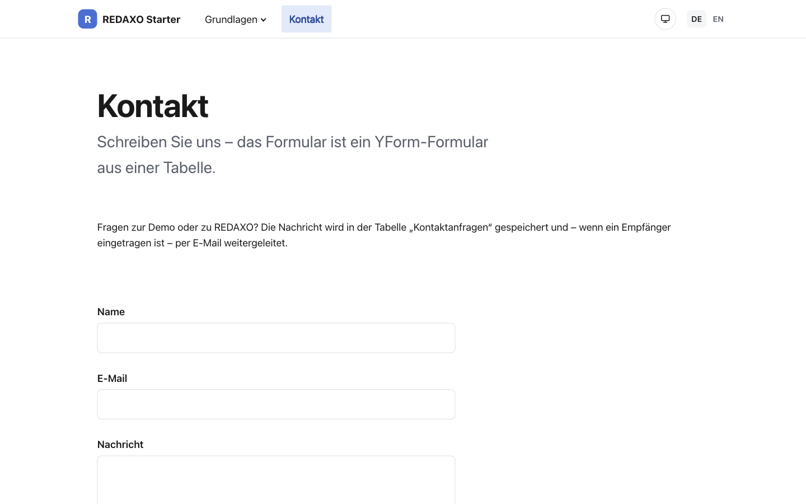 | 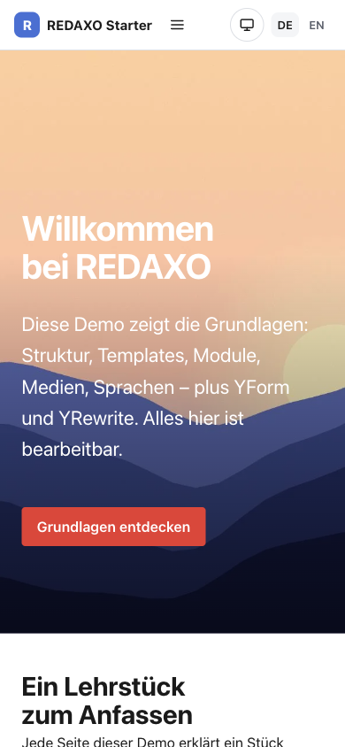 |

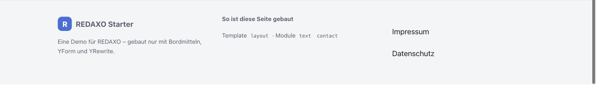

## Im Backend

Unter **AddOns → Starter-Demo**: **Einrichten** zeigt die benötigten AddOns mit Versionsbedingung und installiertem
Stand, richtet die Demo ein und protokolliert jeden Schritt. Der **Rundgang** verlinkt jede Stelle, die die Website erklärt.

| Einrichten | Rundgang |
|---|---|
| 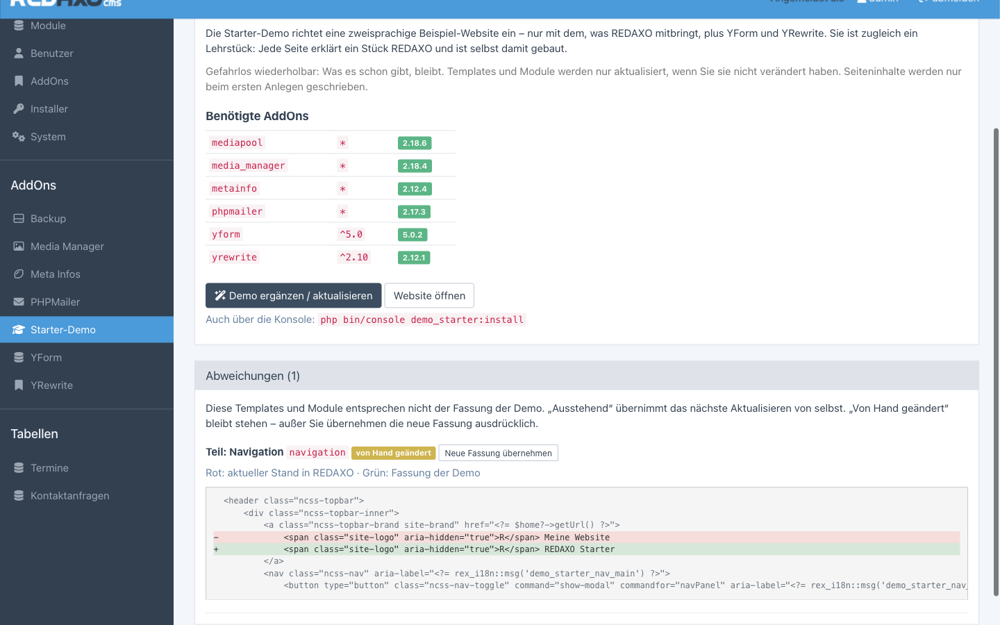 | 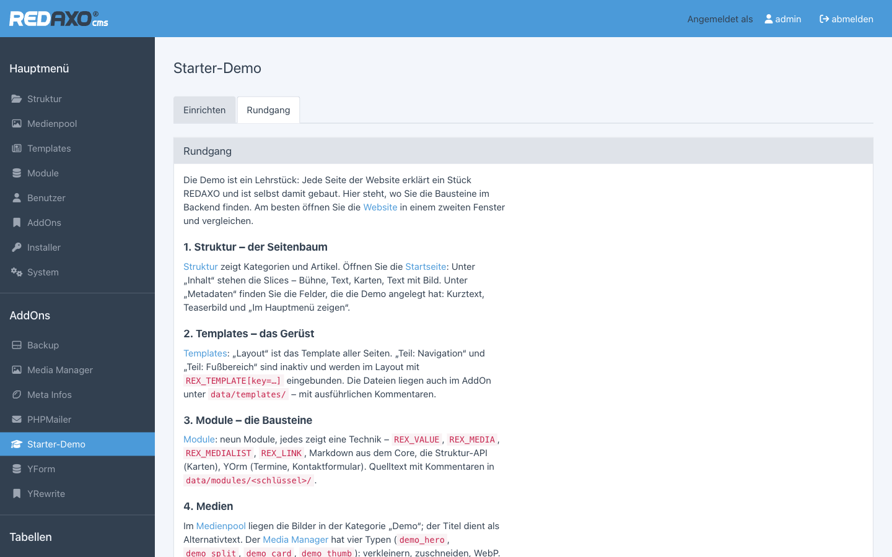 |

---

## Installation

1. AddOn installieren – über den Installer oder als Ordner `redaxo/src/addons/demo_starter`
2. **Starter-Demo → Einrichten → Demo einrichten**, oder auf der Konsole:
   ```
   php bin/console demo_starter:install
   ```

Das ist alles. Medienpool, Media Manager, Metainfo und PHPMailer werden aktiviert, YForm und YRewrite in der neuesten
passenden Version aus dem Installer geholt – auch in einer frischen REDAXO-Installation.

Voraussetzungen: REDAXO ab 5.17, PHP ab 8.1, Apache (für YRewrite wird die `.htaccess` kopiert) oder eine entsprechende
Konfiguration für nginx.

## Warum diese Demo nicht veraltet

| | bisherige Demos | Starter-Demo |
|---|---|---|
| AddOns | feste Datei im Installer („yform 4.1.1“) | **Bedingung** (`^5.0`) – neueste passende stabile Version, notfalls die nächstältere |
| Inhalte | Datenbank-Dump überschreibt die Installation | **Rezept** (`data/recipe.yml`) über `rex_category_service`, `rex_content_service`, `rex_media_service`, YForm-API … |
| Templates, Module | stecken im Dump | **Dateien** mit Kommentaren (`data/templates`, `data/modules`) |
| Wiederholen | überschreibt alles | ergänzt Fehlendes, eigene Änderungen bleiben |
| Frontend | Bootstrap 3 / UIkit | natives CSS – keine Framework-Version, die veraltet |

## Aktualisieren

**YForm, YRewrite und REDAXO selbst** werden wie gewohnt über den Installer aktualisiert. Die Demo gibt nur Bedingungen
vor; für eine neue Hauptversion wird die Bedingung im Rezept angepasst.

**Die Demo selbst:** Nach einem Update des AddOns weist das Backend Admins darauf hin, dass die Inhalte noch von der
vorigen Version stammen. **Demo ergänzen / aktualisieren** (oder `demo_starter:install`) erledigt den Rest:

| Baustein | beim Aktualisieren |
|---|---|
| Templates, Module | neue Fassung, wenn seit dem letzten Einrichten unverändert (Prüfsumme) – sonst bleibt Ihre |
| neue Seiten, Medien, Medientypen, Metainfo-Felder, YForm-Tabellen | werden ergänzt |
| YForm-Felder bestehender Tabellen | fehlende werden ergänzt, vorhandene bleiben |
| abweichende Medientypen, Metainfo-Felder | bleiben – das Protokoll nennt sie |
| Seiteninhalte | werden nie angefasst |

Unter **Einrichten → Abweichungen** stehen Templates und Module, die nicht der Fassung der Demo entsprechen – mit
Zeilen-Vergleich und **Neue Fassung übernehmen** (mit Rückfrage).

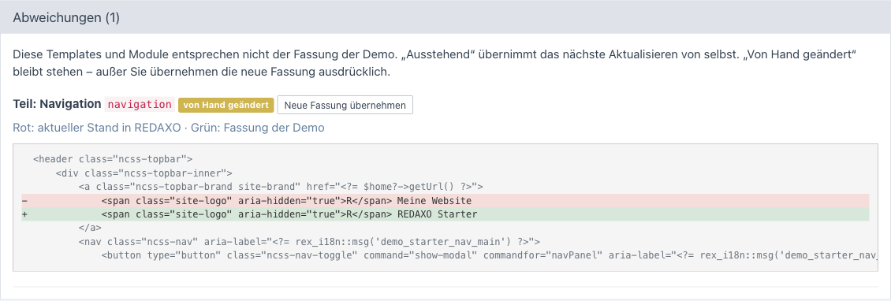

## Das Lehrstück: was wo steckt

| Thema | Datei | zeigt |
|---|---|---|
| Template-Gerüst | `data/templates/layout.php` | `REX_ARTICLE[]`, `REX_TEMPLATE[key=…]`, SEO-Tags von YRewrite, Seitentitel aus dem Artikel |
| Navigation | `data/templates/navigation.php` | `rex_category::getRootCategories()`, Metainfo „Im Hauptmenü zeigen“, Sprachwechsler mit `rex_clang`, Theme-Schalter |
| Fußbereich | `data/templates/footer.php` | Service-Links aus einer Kategorie, „So ist diese Seite gebaut“ aus `rex_article_slice` |
| Text | `data/modules/text/` | `REX_VALUE`, sichere Ausgabe, Markdown mit `rex_markdown` aus dem Core |
| Bühne | `data/modules/hero/` | `REX_MEDIA`, `REX_LINK`, Media Manager |
| Text mit Bild | `data/modules/text_image/` | `rex_media` – Titel als Alternativtext, Bildmaße gegen Springen |
| Karten | `data/modules/cards/` | `rex_category_select`, Struktur-API, Metainfo-Felder |
| Bildergalerie | `data/modules/gallery/` | `REX_MEDIALIST`, natives `<dialog>` als Lightbox |
| Video | `data/modules/video/` | Video aus dem Medienpool mit `<video>` |
| Termine | `data/modules/events/`, `lib/Model/Event.php` | YOrm: Modellklasse, `query()->where()->orderBy()`, Zweisprachigkeit im Modell |
| Kontaktformular | `data/modules/contact/`, `lib/Model/Message.php` | YOrm-Formular aus der Tabelle, `executeForm()`, E-Mail mit `rex_mailer` |
| Hinweis | `data/modules/notice/` | Aussehen über ein Auswahlfeld steuern |
| Hell/Dunkel | `assets/theme.js`, `assets/site.css` | `light-dark()`, `[data-theme]`, kein Aufblitzen |
| Rezept | `data/recipe.yml` | alles, was die Demo anlegt – lesbar |
| Installer | `lib/Installer.php`, `lib/Packages.php` | REDAXO-Services, YForm-Tabellen-API, Versionsauflösung über den Installer |

## Eigene Demo oder eigener Projekt-Starter

Das Rezept ist absichtlich lesbar. `data/recipe.yml`, Templates, Module und Medien anpassen – der Installer bleibt
derselbe. So entsteht ein Starter für eigene Projekte, der sich genauso sicher erneut ausführen lässt.

```
data/recipe.yml          AddOns (Bedingungen), Sprachen, Metainfos, Medientypen, Medien, YForm-Tabellen,
                         Templates, Module, Seiten mit Inhalten je Sprache
data/templates/*.php     Templates
data/modules/<key>/      module.yml, input.php, output.php
data/media/              Bilder und Video, Nachweise in CREDITS.md
lib/                     Installer, Packages (Versionsauflösung), Diff, YOrm-Modelle, Konsolenbefehl
assets/                  site.css, theme.js, ncss/ (nativecss)
docs/tour.*.md           Rundgang im Backend
```

## Bildnachweise

Sechs Landschaften sind für die Demo erzeugt (CC0, siehe `data/media/generator.html`). Bokeh, Glaswürfel und das Intro-Video
stammen aus [demo_uikit3](https://github.com/FriendsOfREDAXO/demo_uikit3). Details: [data/media/CREDITS.md](data/media/CREDITS.md).

## Lizenz

MIT – siehe [LICENSE.md](LICENSE.md). Enthält [nativecss](https://github.com/skerbis/nativecss) (MIT).

## Autor

**Friends Of REDAXO** – https://github.com/FriendsOfREDAXO

**Projektleitung:** [Thomas Skerbis](https://github.com/skerbis)
